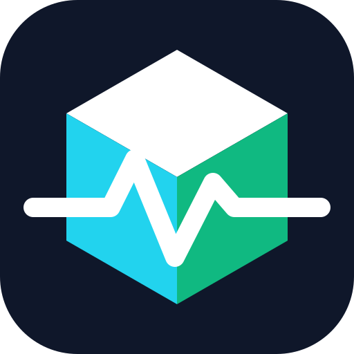
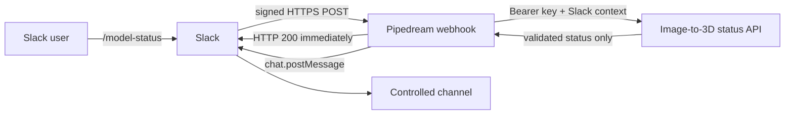
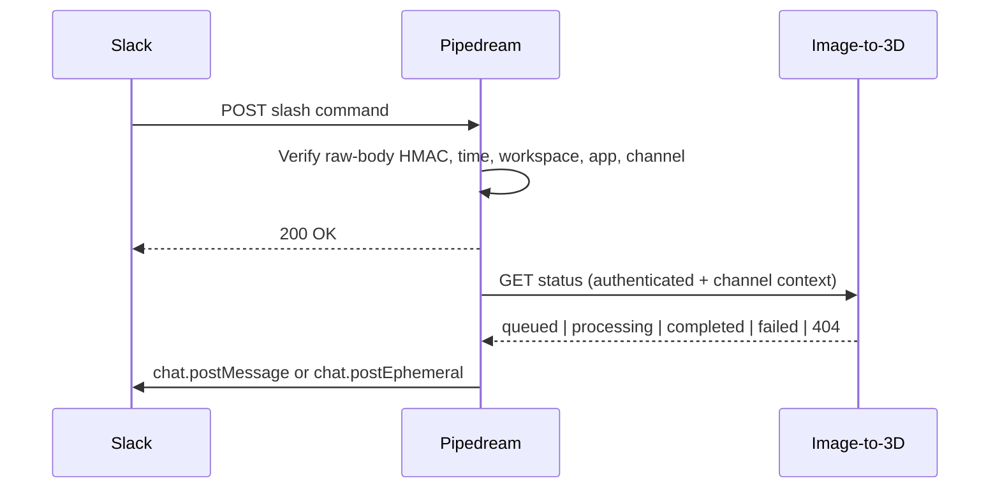

<p align="center">
  
</p>

# RenderPulse

[](https://github.com/AsimAslah/RenderPulse/actions/workflows/ci.yml)
[](LICENSE)
[](https://github.com/AsimAslah/RenderPulse/releases)
[](package.json)
[](package.json)
[](docs/SLACK_SETUP.md)
[](docs/DEPLOYMENT.md)
[](docs/TESTING.md)
[](docs/TESTING.md#verified-live-checks)

**Your 3D renders. One command away.**

RenderPulse is a focused Slack app that retrieves real [Image-to-3D](https://github.com/AsimAslah/Image-to-3D) render status with `/model-status <render_id>`. It acknowledges signed Slack requests before doing network work, queries an authenticated read-only API, and posts an accessible Block Kit response to an explicitly allowed channel.

## Why it exists

3D generation can be slow, while the team coordinating assets often works in Slack. RenderPulse provides a narrow status view without granting Slack access to model files, browsing channel history, or reading user profiles.

## Features

- `/model-status R1024` plus private help and validation responses
- Real queued, processing, completed, failed, and not-found states
- Raw-body HMAC-SHA256 verification and five-minute replay window
- Pipedream raw-request header normalization without weakening signature checks
- Workspace, app, channel, user, render-ID, and backend authorization checks
- Immediate HTTP 200 acknowledgement before the backend lookup
- Authenticated backend calls with a strict timeout and response validation
- Bounded Slack retries that honor `Retry-After`
- Portable Slack manifest with only `commands` and `chat:write`
- Deployable Pipedream code and a compatible Image-to-3D backend extension

## Architecture





See [architecture decisions](docs/ARCHITECTURE.md) and the [security model](docs/SECURITY.md).

## OAuth permissions

| Scope | Reason |
| --- | --- |
| `commands` | Registers and receives `/model-status`. |
| `chat:write` | Posts status in a channel where RenderPulse is present and sends private usage errors. |

No event subscriptions, message listeners, Socket Mode, history, file, user, admin, or `chat:write.public` permission is used. Changing scopes requires reauthorization or reinstalling the app.

## Quick start

Requirements: Node.js 20+ and access to a deployed Image-to-3D status endpoint.

```bash
npm ci
npm test
npm run lint
cp .env.example .env
```

Fill `.env` locally; never commit it. Then follow:

1. [Image-to-3D integration](integrations/image-to-3d/README.md)
2. [Slack sandbox setup](docs/SLACK_SETUP.md)
3. [Pipedream deployment](docs/DEPLOYMENT.md)
4. [End-to-end testing](docs/TESTING.md)

## Command behavior

```text
/model-status <render_id>
/model-status help
```

Successful lookups are posted to the originating allowed channel. Usage errors, not-found results, authorization failures, and service failures are private to the requesting user. Progress is displayed only when the backend supplies a validated real value; the provided Image-to-3D extension does not invent progress.

## Configuration

| Variable | Purpose |
| --- | --- |
| `SLACK_BOT_TOKEN` | Bot token used only for Slack Web API calls. |
| `SLACK_SIGNING_SECRET` | Verifies the original Slack request body. |
| `SLACK_TEAM_ID` / `SLACK_APP_ID` | Pins requests to the intended installation. |
| `SLACK_ALLOWED_CHANNEL_IDS` | Comma-separated controlled channels. |
| `RENDER_API_BASE_URL` | HTTPS Image-to-3D backend base URL. |
| `RENDER_API_KEY` | Shared backend bearer credential. |
| `RENDER_API_TIMEOUT_MS` | Lookup timeout, 100–30000 ms. |

Use Pipedream secrets for deployment values. Do not place secrets, response URLs, raw Slack payloads, or model URLs in logs.

## Development

```bash
npm run lint
npm test
npm run coverage
```

The current local verification result is recorded in [TESTING.md](docs/TESTING.md). CI runs syntax checks, tests, coverage collection, and `npm audit`. Coverage is intentionally not represented by a badge until it is published by CI.

## Screenshots and evidence

No simulated screenshots are presented as Handshake evidence. The `screenshots/` directory is reserved for redacted captures from the deployed Slack sandbox. Follow [HANDSHAKE_SUBMISSION.md](docs/HANDSHAKE_SUBMISSION.md) for the exact capture list.

## Deployment status

The Slack app is installed in the RenderPulse developer workspace, Pipedream workflow v9 is active, the app is present in the controlled channel, and `/model-status help` returns the expected private response. A signed production probe also verified HMAC acceptance and controlled-channel rejection, while an authenticated backend probe verified the deployed bearer key. See [TESTING.md](docs/TESTING.md#verified-live-checks) for the exact boundary of these claims.

## Known limitations

- Real render-state responses, measured acknowledgement latency, and the redacted Handshake evidence set remain release gates; they are not inferred from the verified help and security-path checks.
- Pipedream must expose the raw request body; the workflow fails closed if it does not.
- In-memory duplicate suppression is process-local. Slack's five-minute signed-request window limits replay; high-scale multi-worker deployment should add a shared idempotency store.
- Image-to-3D currently performs conversion synchronously. Status transitions are real and persistent, but a caller only receives the public RenderPulse ID when that request returns.

## Contributing and license

See [CONTRIBUTING.md](CONTRIBUTING.md). RenderPulse is available under the [MIT License](LICENSE).
